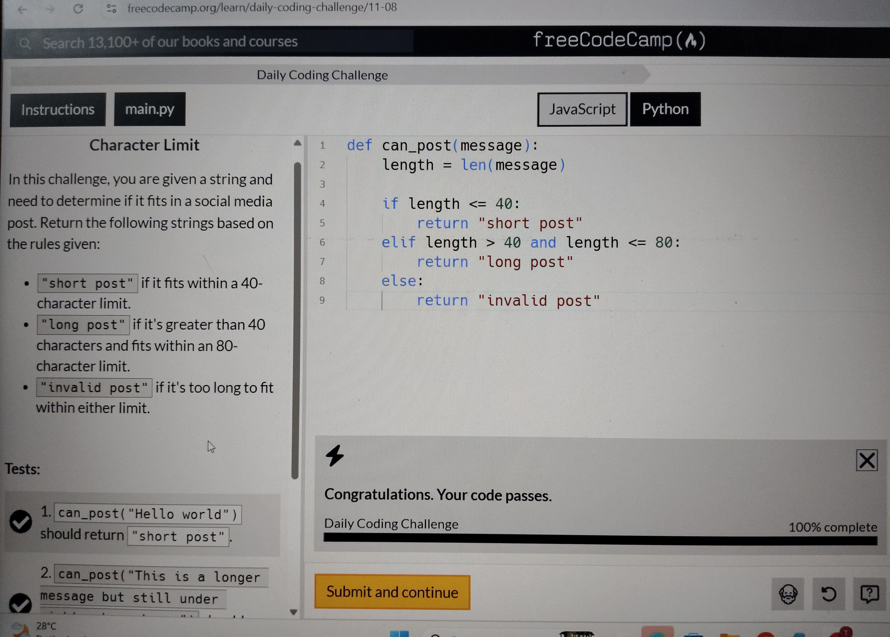

## Character Limit – Python Coding Challenge

### Problem

Determine whether a social media post fits within the character limits.

- Up to 40 characters: ""short post""
- More than 40 and up to 80 characters: ""long post""
- More than 80 characters: ""invalid post""

### Concepts Practiced

- "len()" function
- If, elif, and else conditions
- Logical operator ("and")
- Comparison operators
- Return statement
- String length calculation
- Boundary value checking

### Test Results

All 3 FreeCodeCamp test cases passed successfully (3/3).

### 📸 Challenge Completed

