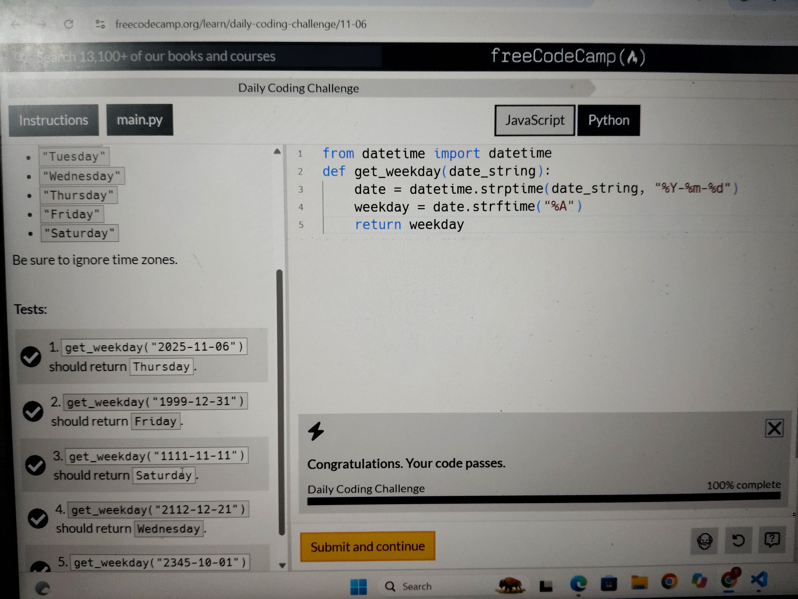

## 📅 Daily Progress

Day| Challenge| Status
Day 10| Weekday Finder| ✅ Completed

🏆 Latest Achievement

# Day 10 – Weekday Finder

- Platform: freeCodeCamp
- Language: Python
- Tests Passed: 5/5
- Concepts: datetime, strptime(), strftime(), Date Formatting

### 📚 Learning Progress

Continuously practicing Python through daily coding challenges.

### My learning approach:

- Understand the problem before coding.
- Learn the concepts and methods used.
- Write the solution independently.
- Test the code and fix errors.
- Document daily learning progress.

### 🎯 Goal

Improve Python programming skills, problem-solving ability, and logical thinking through consistent daily practice.

One challenge at a time. One concept at a time. 🚀

### Test Results

All 5 FreeCodeCamp test cases passed successfully (5/5).

### 📸 Challenge Completed

