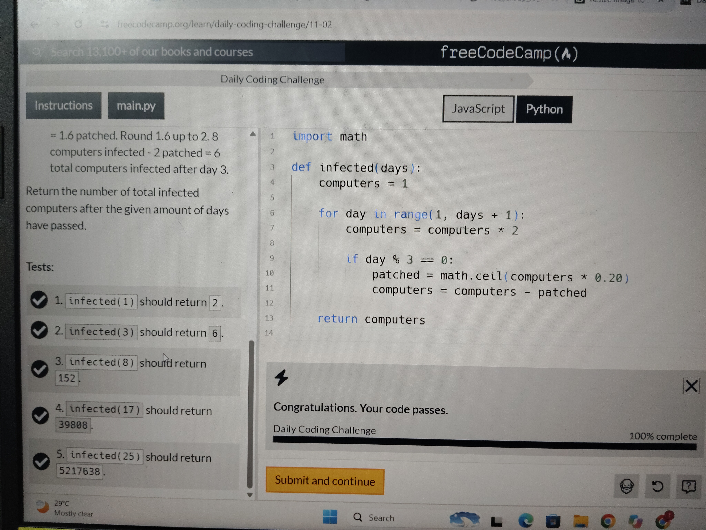

# Day 06 – Infected 🦠

Platform: FreeCodeCamp
Language: Python
Status: Completed
Test Results: 5/5 passed

## Challenge: 

Simulate the spread of an infection where infected computers double every day and a patch is applied every third day.

## Python Concepts Learned

- Variables and reassignment
- "for" loops and "range()"
- Multiplication and subtraction
- Modulo operator ("%")
- Conditional statements ("if")
- "import math" and Python modules
- "math.ceil()" for rounding up
- "return" statements
- Indentation and code structure

## What I Understood

- How to update a variable using its previous value.
- How loops repeat calculations for each day.
- How "%" identifies every third day.
- How to calculate 20% of a value.
- Why "math.ceil()" is used instead of "round()" when rounding up is required.
- How to subtract patched computers from the infected count.

## Independent VS Code Practice

- Created and ran a Python file independently.
- Practiced writing the function structure and indentation.
- Used "import math" to access the "ceil()" function.
- Implemented the daily doubling logic using a "for" loop.
- Added the patch condition using modulo and "if".
- Debugged small coding and placement mistakes independently.
- Tested multiple inputs using "print()".

## Local Test Results

Input| Expected Output| Actual Output
"infected(1)"| 2| 2
"infected(3)"| 6| 6
"infected(8)"| 152| 152
"infected(17)"| 39808| 39808
"infected(25)"| 5217638| 5217638

## Key Takeaway:

Learned to combine loops, conditions, mathematical calculations, and rounding to solve a practical simulation problem. Also practiced independently implementing and testing the solution in VS Code.

# Code

See solution.py file 

## Test Results

All 5 FreeCodeCamp test cases passed successfully (5/5).

## 📸 Challenge Completed

