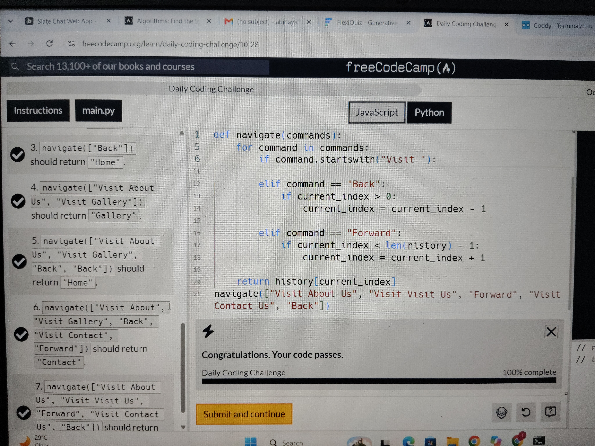

# Navigator — Python Coding Challenge

## 📌 Challenge Overview

The Navigator challenge simulates browser navigation. It starts at the Home page and processes commands to visit pages, go back, and move forward.

### 🧠 Concepts Practiced

- Lists
- "for" loops
- "if" and "elif" conditions
- String methods: "startswith()" and "replace()"
- List slicing
- "append()"
- "len()"
- Index tracking

### ⚙️ My Approach

1. Start the browsing history with "Home".
2. Use "current_index" to track the current page.
3. Process each navigation command one by one.
4. When visiting a new page, remove any forward history before adding the page.
5. Update the index when moving backward or forward.
6. Return the page at the current index.

### 🐛 Debugging Lesson

The "replace()" method can replace multiple occurrences of a matching string by default.

Using "replace("Visit ", "", 1)" removes only the first occurrence, preserving the rest of the page name.

### 💡 Key Takeaway

I learned how a list and an index can represent browser history, and why forward history must be removed when visiting a new page after going backward.

### 📈 Status

Practiced and debugged as part of my Python learning journey.

### 📸 Challenge Completed

