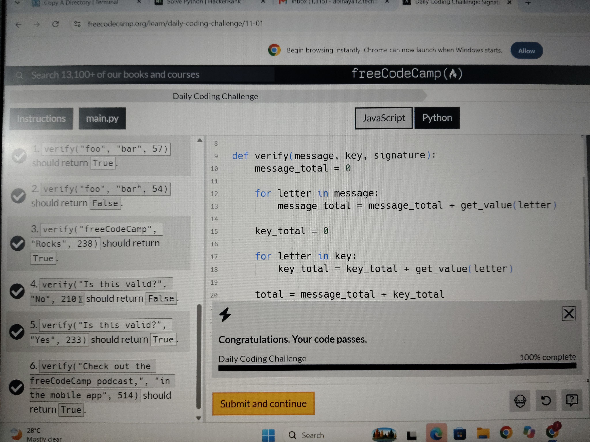

# Signature Validation

Platform: FreeCodeCamp
Language: Python
Status: Completed
Test Results: 6/6 passed

## Problem

Calculate a signature by adding the numerical values of all letters in the message and secret key. Compare the calculated value with the supplied signature.

## Concepts Practiced

- Character conversion using "ord()"
- "islower()" and "isupper()"
- Helper functions
- "for" loops
- Conditional statements
- Boolean comparison

## Result

Implemented the "verify()" function and successfully passed all 6 test cases.

## Solution

See "solution.py".

## Test Results

All 5 FreeCodeCamp test cases passed successfully (6/6).

## 📸 Challenge Completed

