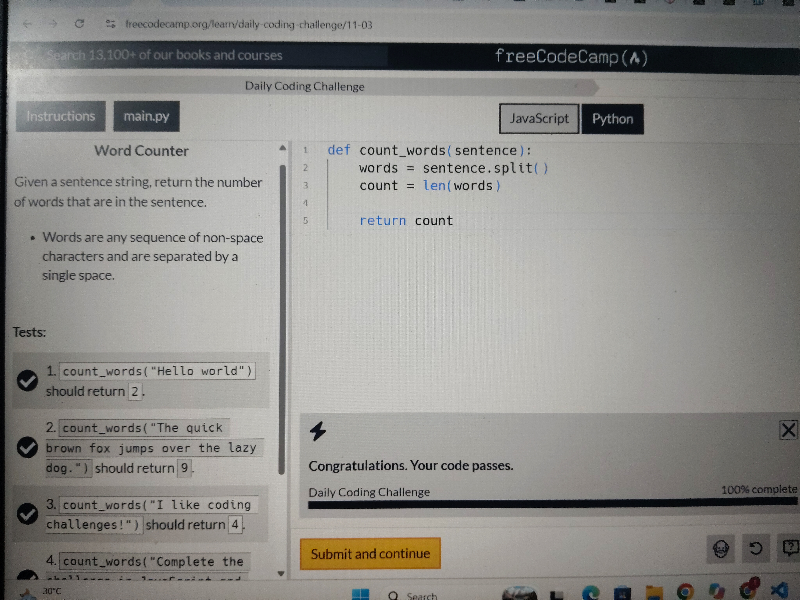

# Word Counter

## Problem Description

Given a sentence string, return the number of words in the sentence.

Words are defined as sequences of non-space characters separated by a single space.

## Python Concepts Used

- "split()" – Splits a sentence into a list of words.
- "len()" – Counts the number of words in the list.
- Functions and return statements.

## Solution Approach

1. Accept the sentence as input.
2. Use "split()" to separate the sentence into words.
3. Use "len()" to count the words.
4. Return the total count.

## Example

Input:

"I love coding challenges!"

Output:

4

## Test Results

- All 5 test cases passed successfully.

## Language

Python 3

# Code

See solution.py file 

## Test Results

All 5 FreeCodeCamp test cases passed successfully (5/5).

## 📸 Challenge Completed

